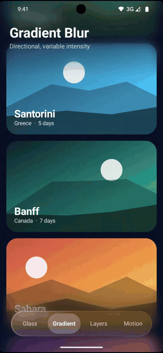
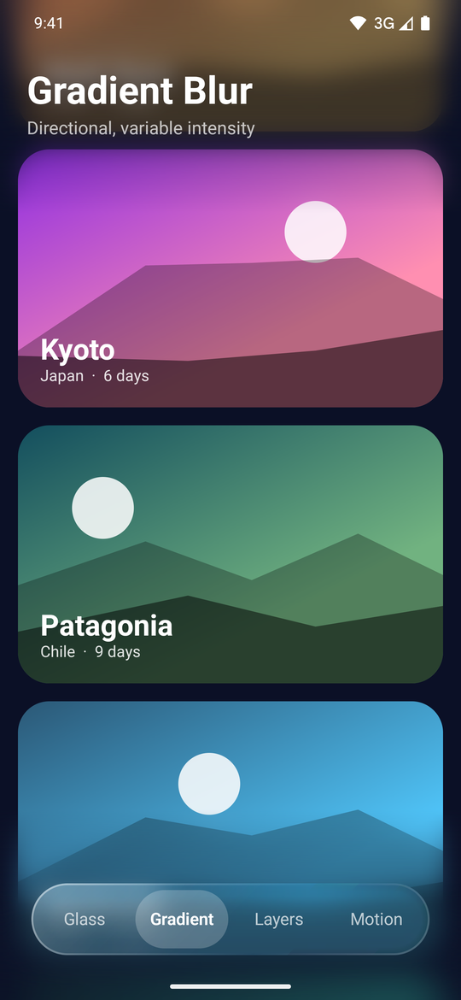
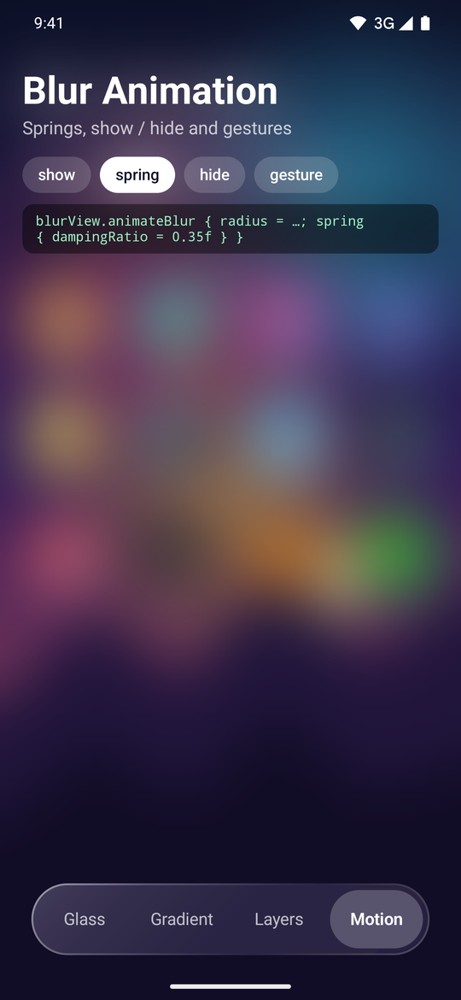

# Blur Engine

Background blur for Android Views and Jetpack Compose. API 29+ (Android 10).

- Blurs what is behind a `BlurView` or a `Modifier.blurSurface`, with tint, saturation, brightness and rounded corners.
- Picks a renderer by itself: `RenderEffect` on API 31+, OpenGL ES 2.0 Dual Kawase on API 29 and 30, and a CPU fallback.
- Liquid glass, progressive (gradient) blur and stacked glass surfaces.
- Frame-synchronized, interruptible animations (tweens, springs, gesture progress), with no allocations per frame.

Measurements and known limits: [docs/PERFORMANCE.md](docs/PERFORMANCE.md). Version history: [CHANGELOG.md](CHANGELOG.md).

## Demo

| Liquid Glass | Gradient Blur | Multi-layer Blur | Blur Animation |
| :---: | :---: | :---: | :---: |
|  |  |  |  |
| Refraction, dispersion, rim light and gloss | Blur intensity that varies across the surface | Independent surfaces that blur each other | `show`, `hide`, springs and `setBlurProgress` |

<details>
<summary>Still screenshots</summary>

| Liquid Glass | Gradient Blur | Multi-layer Blur | Blur Animation |
| :---: | :---: | :---: | :---: |
|  |  |  |  |

</details>

Recorded on an Android 15 emulator from the [`blur-showcase`](blur-showcase) app (`gradlew :blur-showcase:installDebug`). Everything is drawn live: the landscape and "photos" are procedural, and the floating tab bar is itself a glass surface over each screen.

### Re-recording the demo

[`scripts/record-demo.ps1`](scripts/record-demo.ps1) regenerates every file in `docs/media/` (all four screens) on a running emulator or device:

```powershell
.\scripts\record-demo.ps1                       # build, install, record all four screens
.\scripts\record-demo.ps1 -SkipBuild -Seconds 12 -Screens glass
```

The script needs `adb` (found through `ANDROID_HOME` or the default SDK location) and `ffmpeg` on `PATH` (or `-Ffmpeg <path>`). It:

1. builds and installs `blur-showcase`;
2. turns on System UI demo mode (9:41 clock, full battery, no notifications);
3. launches each screen (`glass`, `gradient`, `layers`, `motion`) with `--ez autoplay true`, so the app plays scripted motion (a drifting lens, auto-scrolling, cards fanning out, the animation sequence) instead of jerky `adb input` gestures;
4. saves a screenshot, records with `screenrecord` at half resolution, and converts the clip to a GIF with a two-pass palette;
5. turns demo mode off again.

Use API 33+ to get refraction in the recording; on older versions the glass shows lighting only. You can also open a screen by hand, with or without autoplay: `adb shell am start -n dev.blurengine.mrsluffy.showcase/.ShowcaseActivity --es screen layers --ez autoplay true`.

## Install

```kotlin
dependencies {
    implementation("io.github.mrsluffy:blur-view:1.0.0")     // Android Views
    implementation("io.github.mrsluffy:blur-compose:1.0.0")  // Jetpack Compose (also brings in blur-view)
}
```

The artifacts are on Maven Central (`mavenCentral()`). Packages are under `dev.blurengine.mrsluffy`.

## Quick start

```kotlin
// View
val bar = BlurView(context).apply {
    blurRadius = 20f
    setTint(Color.WHITE, 0.15f)
}
bar.animateBlur { radius = 30f; spring() }

// Compose
Box(Modifier.blurSurface { radius = 25.dp; tint(Color.White.copy(alpha = 0.15f)); cornerRadius(24.dp) })
```
## Effects

```kotlin
// Liquid glass: rim highlight, gloss and edge shading everywhere; refraction and dispersion on API 33+
blurView.cornerRadius = 28 * density
blurView.glass = GlassStyle(refraction = 14 * density, edgeWidth = 20 * density, dispersion = 0.35f)

// Progressive blur: 0 at the start of the gradient, full blur at the end
header.gradient = BlurGradient.BottomToTop   // blurred at the top, clear at the bottom

// Compose
Modifier.blurSurface {
    radius = 28.dp
    cornerRadius(32.dp)
    glass(refraction = 14.dp, edgeWidth = 20.dp, highlight = 0.8f)
}
Modifier.blurSurface { radius = 40.dp; gradient = BlurGradient.TopToBottom }
```

- **Liquid glass:** on API 33+, the refraction is an AGSL shader chained after the blur. It runs on the GPU and costs no main-thread time. The rim bends the content just inside it toward the edge, and `dispersion` splits red and blue there. On API 29–32 the lighting is drawn without refraction. The rim follows the corner radius.
- **Progressive blur:** `BlurGradient` presets are `TopToBottom`, `BottomToTop`, `LeftToRight` and `RightToLeft`. Where the intensity is 0, the real content shows through unchanged.
- **Multi-layer blur:** surfaces need no setup to stack. A blur surface shows every blur surface drawn before it, through that surface's own blur, and leaves out itself and everything drawn after it. Stacking order is drawing order.

## BlurView

```kotlin
// Level 1
val bar = BlurView(context).apply {
    blurRadius = 20f
    setTint(Color.WHITE, 0.15f)
}

// Level 2: builder DSL
val card = BlurView(context) {
    radius = 24f
    algorithm = BlurAlgorithm.DUAL_KAWASE
    overlay { color = Color.WHITE; alpha = 0.18f }
    shape { cornerRadius = 24f }
    performance { quality = BlurQuality.BALANCED; downsample = 4 }
}
card.sourceView = scrollView   // optional; default is the whole window
```

From XML:

```xml
<dev.blurengine.mrsluffy.view.BlurView
    android:layout_width="match_parent"
    android:layout_height="96dp"
    app:blurRadius="24dp"
    app:blurTintColor="#FFFFFF"
    app:blurTintAlpha="0.2"
    app:blurCornerRadius="24dp"
    app:blurAlgorithm="auto">
    <!-- children are drawn on top, unblurred -->
</dev.blurengine.mrsluffy.view.BlurView>
```

Other properties: `saturation`, `brightness`, `downsample`, `algorithm`, `quality`, `config` (the whole `BlurConfig`), and `invalidateBlur()`. `activeRenderer` and `lastUpdateMillis` are diagnostics.

### How it works

1. **Capture.** Before each frame, the region of the source view under the `BlurView` is drawn into a bitmap at 1/`downsample` size using a software canvas. The capture also takes up to 1.5 × radius (3 sigma) of margin on each side, limited to the source's bounds, so content just outside the view bleeds in as it would in a real blur. While capturing, every `BlurView` skips drawing itself, so it never blurs its own output.
2. **Blur.**
   - API 31+ with `AUTO` or `GAUSSIAN`: a `RenderNode` with a `RenderEffect` blurs the capture on the GPU, with no readback.
   - Otherwise: the GLES backend blurs it, falling back to software if GLES fails or the algorithm is `BOX`.
3. **Draw.** The result is re-recorded into a `RenderNode` during the frame that's already being drawn. `BlurView` never invalidates itself from there, so updating the blur doesn't schedule extra frames.

Resources are released when the view is detached and recreated when it's attached again.

### Limitations

- **Missing content.** Software drawing can't render SurfaceView or TextureView (video, camera, maps), so they're missing from the blur.
- **HARDWARE bitmaps.** Since 0.8, HARDWARE bitmaps (the default in Coil and Glide) are captured when drawn with `drawBitmap`, which covers ImageView and Compose Image. Each is copied once at capture resolution and cached. Inside a `BitmapShader` they still make the capture fail, and a warning is logged once.
- **Other BlurViews.** A blur surface shows the ones drawn before it, but only through their software frame. On the RenderEffect path that frame is the unblurred, tinted capture, which the upper surface then blurs.
- **Software canvases.** When the view is drawn into a software canvas (for example `View.draw(bitmap canvas)`), the RenderEffect path shows only the tint.
- **First frame without blur.** The GLES and software backends warm up on a background thread, so the view doesn't stutter. For the first 100–400 ms after it attaches, though, a `BlurView` that doesn't use RenderEffect shows only its tint.

## Jetpack Compose (`blur-compose`)

```kotlin
Box(
    Modifier.blurSurface {
        radius = 25.dp
        tint(Color.White.copy(alpha = 0.15f))
        cornerRadius(24.dp)
    }
)

BlurContainer(blur = { radius = 32.dp; tint(Color.White.copy(alpha = 0.4f)) }) {
    Text("Frosted bar")   // content draws on top, unblurred
}
```

Settings: `radius`, `tint`, `saturation`, `brightness`, `shape` / `cornerRadius()`, `algorithm`, `quality`, `downsample`, `progress` (0..1, for gestures) and `source`.

**Animating:** use Compose's own animation APIs, and read the animated value *inside* the block:

```kotlin
val radius = animateDpAsState(if (expanded) 48.dp else 12.dp, spring())
Modifier.blurSurface { this.radius = radius.value }
```

The block runs during the frame, not during composition, and re-runs when the state it reads changes. Animation frames therefore don't recompose. A device test checks this: an animation caused one recomposition, for the target change, and none for its frames.

**Naming:** a local variable named like a setting (for example `val radius = ...`) shadows that setting inside the block, because Kotlin gives locals precedence over receiver members. Use `this.radius = ...` or rename the local.

**Shared engine:** `blur-compose` uses the same `BlurSurfaceRenderer` as `BlurView`, so it has the same capture, render paths, edge margin, warm-up and limitations. The module is optional, and View-only apps don't pull in Compose. It's built with Compose BOM 2024.09.00 and Kotlin 2.0.20.

### `BlurSurfaceRenderer` (advanced)

`BlurView` and the Compose modifier are thin wrappers around `dev.blurengine.mrsluffy.view.BlurSurfaceRenderer`. You can use it directly for a custom surface:
1. Implement `BlurTarget` (size, window position, visibility, invalidate).
2. Call `attach()` and `detach()`.
3. Call `draw(canvas)` from your draw method.
4. Skip drawing while `CaptureGuard.shouldSkip(canvas)` returns true.

## Animation

```kotlin
// Duration-based
blurView.animateBlur { radius = 30f; duration = 300L }

// Spring
blurView.animateBlur {
    radius = 30f
    spring { dampingRatio = 0.75f; stiffness = 350f }
}

// From/to ranges, several properties at once
blurView.animateBlur { radius(0f, 30f); tintAlpha(0f, 0.2f); spring() }

// Appear / disappear
blurView.show(duration = 350L, radius = 24f)
blurView.hide(duration = 250L)          // ends INVISIBLE

// Gesture-driven: 0 = no blur, 1 = the configured blur
blurView.setBlurProgress(sheetExpandedFraction)
```

You can animate the radius, tint color, tint alpha, saturation and brightness. Choose an interpolator with `interpolator = BlurInterpolators.FAST_OUT_SLOW_IN` (the default), `LINEAR`, `EASE_IN_OUT`, `DECELERATE` or `cubicBezier(...)`. Set `onEnd = BlurAnimationListener { finished -> }` to be told when an animation finishes.

How animations behave:

- **Two states.** `config` is the configured state: what `show()` returns to and what `animateBlur` changes. `displayedConfig` is what's on screen right now. `show`, `hide` and `setBlurProgress` move only the displayed state, between the configured state and fully hidden (radius 0, no tint). Setting `config` or any property applies immediately and stops animations.
- **Interruptible.** A new animation starts from what's on screen, and springs keep their velocity. Each property animates on its own, so starting a tint animation doesn't stop a radius animation. An interrupted animation reports `finished = false`. For example, an interrupted `hide()` leaves the view visible.
- **Frame-synchronized.** One Choreographer clock drives each view, and timing uses frame timestamps, so it follows 60, 90 and 120 Hz displays. Springs use the closed-form damped-spring equations, the same as AndroidX `SpringForce`.
- **Reduced motion.** The system's animator duration scale is respected. A scale of 0 (animations off) jumps straight to the end. Set `respectsAnimationScale = false` to opt out.
- **Lifecycle.** Detaching the view jumps running animations to their end. Callbacks run on the main thread.

### Cost per animation frame

- **Animator:** the animator itself doesn't allocate. A test measures fewer than 1 KB allocated over 1,000 frames.
- **Per-frame objects:** applying each frame creates a `BlurConfig` copy, and on API 31+ a new `RenderEffect`. Android's `RenderEffect` can't be changed once created.
- **Buffers:** the capture margin is rounded up to 64 px steps, and bitmaps reuse their memory (`Bitmap.reconfigure`). An animating radius therefore resizes buffers only now and then, not every frame.
- **Zero blur:** at radius 0 (the end of `hide()`, or `setBlurProgress(0)`), the capture is skipped entirely.
- **Backend warm-up:** the GLES and software backends are created on a background thread when the view attaches, or when the algorithm changes. Until a backend is ready, the view shows its previous frame or just the tint. EGL setup therefore no longer stalls the first frame of an animation.

Measured on emulators, a 400 ms radius animation from 0 to 40 updated on 16 to 24 frames:

| | Android 10 (GLES) | Android 15 (RenderEffect) | Android 15 (GLES) |
| --- | --- | --- | --- |
| Distinct values per 400 ms animation | 16 to 24 | 24 | 23 |
| Main-thread cost per animated frame | 8 to 13 ms | 0.2 ms | 8.4 ms |

## Modules

| Module | Type | Contents |
| --- | --- | --- |
| `blur-core` | Kotlin/JVM | `BlurConfig` + DSL, `BlurAlgorithm`, `BlurQuality`, `PixelBuffer`, `PixelBufferPool`, backend contract, `BlurSource`, `BlurRenderScheduler` + `FrameDrivenScheduler` |
| `blur-algorithms` | Kotlin/JVM | `GaussianBlur` + `GaussianKernel`, `DualKawaseBlur` (calibrated), `BoxBlur`, `Resampler`, `ColorAdjust` |
| `blur-platform` | Android library | `RenderEffectBlurBackend`, `GlesBlurBackend`, `SoftwareBlurBackend`, `BitmapImage`, `BlurRenderEffects`, `DeviceCapabilitiesDetector` |
| `blur-render` | Android library | `BlurBackendSelector`, `ChoreographerFrameClock` |
| `blur-capture` | Android library | `ViewCapture`, `CaptureGuard`, `CaptureGeometry`, `ReusableBitmap` |
| `blur-animation` | Kotlin/JVM | `BlurAnimator`, `BlurValues`, `BlurAnimationSpec` (tween, spring, snap), `BlurInterpolators`, `BlurSpring`, `blurAnimation { }` DSL |
| `blur-view` | Android library | `BlurView`, `BlurSurfaceRenderer`, `BlurTarget` |
| `blur-compose` | Android library (Compose) | `Modifier.blurSurface { }`, `BlurContainer`, `BlurSurfaceScope` |
| `blur-samples` | Android app | One screen per feature (`BlurView`, animation, Compose, effects, bitmap backends) |
| `blur-showcase` | Android app (Compose) | The demo app: liquid glass, gradient blur, multi-layer blur and blur animation, with an `autoplay` mode for recordings |

## Backends (bitmap to bitmap)

| Backend | API | Algorithms | Notes |
| --- | --- | --- | --- |
| `render-effect` | 31+ | Gaussian, AUTO | Platform `RenderEffect` drawn offscreen through `HardwareRenderer` and `ImageReader` |
| `gles` | 29+ (OpenGL ES 2.0) | Dual Kawase, Gaussian | Own offscreen EGL context. Rebuilds itself and retries once if the context is lost |
| `software` | 29+ | All | CPU reference implementation |

```kotlin
val backend = BlurBackendSelector().selectAndInitialize(config, DeviceCapabilitiesDetector.detect(context))
backend.render(BitmapImage(source), BitmapImage(output)) // off the main thread
backend.release()
```

Every backend targets the same blur strength: sigma = radius / 2. Dual Kawase's iterations and sample offset come from a measured table, so it matches the Gaussian within 12% for radii 3 to 100.

## Measured results (x86_64 emulators)

The full report, including benchmarks, scrolling frame times and lifecycle tests, is in [docs/PERFORMANCE.md](docs/PERFORMANCE.md).

Emulator timings are rough comparisons, not device numbers.

| | Android 10 (API 29) | Android 15 (API 35) |
| --- | --- | --- |
| `BlurView` renderer with AUTO | gles | render-effect |
| `BlurView` main-thread cost per frame, 600x400 view, steady state | gles ~5 to 9 ms | render-effect 0.2 ms, gles 6.8 ms, software 9.2 ms |
| GLES vs CPU output, mean difference per channel | 0.01 to 0.73 / 255 | 0.01 to 0.73 / 255 |
| RenderEffect vs CPU Gaussian, mean difference | n/a | 0.11 to 0.28 / 255 |
| Bitmap backend, 1080x2400, ds=4: GLES / RenderEffect | 35 to 42 ms / n/a | 36 ms / 29 to 33 ms |

## Tests

- **JVM:** algorithms, calibration, config, scheduler, pool, selector, capture geometry.
- **`blur-platform` device tests:** each GPU backend vs the CPU backend, GLES recovery after context loss, size changes, timings.
- **`blur-view` device tests:** these take real screen screenshots and check that:
  - content under the view is blurred and content outside stays sharp
  - the blur lines up with the content behind it to within 6 px
  - the output is stable across frames (no self-capture)
  - the blur follows content changes
  - content outside the view bleeds into its edges
  - tint and rounded corners apply
  - the view still works after detach and reattach
  - each algorithm uses the expected renderer

- **`blur-animation` JVM tests:**
  - durations, interpolators, and 60 vs 120 Hz timing
  - springs: overshoot depends on damping, and they settle exactly on target
  - interruption keeps value and velocity continuous
  - properties animate independently
  - duration scale, including 0, which snaps
  - `cancel` and `end`
  - a listener can start the next animation
  - frames don't allocate
- **`blur-view` animation device tests:**
  - an animation advances on every frame through Choreographer (RenderEffect and GLES)
  - `hide` then `show`
  - `show` interrupting a `hide`
  - progress 0, 0.5 and 1, where 0 skips capture
  - system animations turned off

- **`blur-compose` device tests:**
  - blur behind the surface, aligned within 6 px (RenderEffect and GLES)
  - an animated radius doesn't recompose
  - progress 0 shows the content sharp
  - the shape clips the blur
  - content draws on top and is left out of the blur
  - the output is stable across frames

All of these pass on the Android 10 and Android 15 emulators: 60 JVM tests, plus 13–14 `BlurView`, 6 Compose and 6–7 backend device tests per device. The device tests turn off window animations while they run, so screenshots never catch an activity still animating in.

On a freshly booted emulator (load average above 10), screenshot and frame-timing tests can fail. Let it settle first.

```
gradlew test
gradlew connectedDebugAndroidTest   # needs an emulator or device
gradlew :blur-samples:assembleDebug
gradlew :blur-showcase:installDebug   # the demo app
gradlew spotlessApply                # add the Apache license header to new source files
```

## License

```
Copyright 2026 MrSluffy

Licensed under the Apache License, Version 2.0 (the "License");
you may not use this file except in compliance with the License.
You may obtain a copy of the License at

    http://www.apache.org/licenses/LICENSE-2.0

Unless required by applicable law or agreed to in writing, software
distributed under the License is distributed on an "AS IS" BASIS,
WITHOUT WARRANTIES OR CONDITIONS OF ANY KIND, either express or implied.
See the License for the specific language governing permissions and
limitations under the License.
```

The full text is in [LICENSE](LICENSE).
