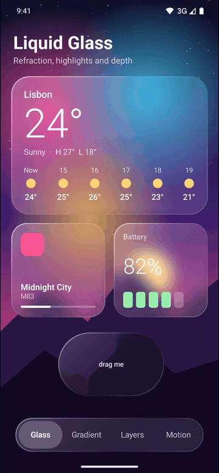
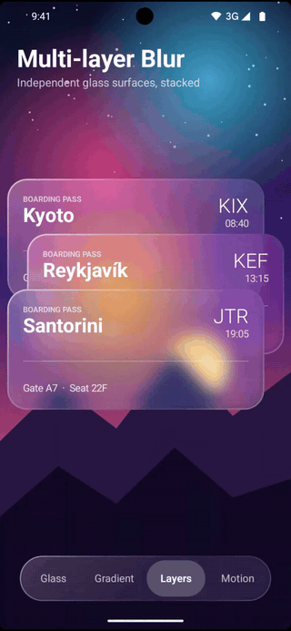
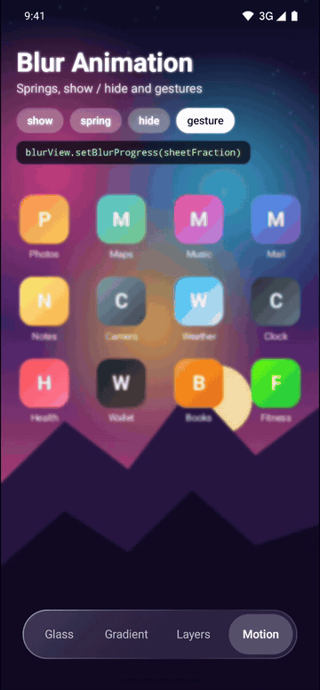

# Blur Engine

Real-time background blur, liquid glass and progressive blur for Android Views and Jetpack Compose. Android 10 (API 29) and up.

**[Documentation](https://mrsluffy.github.io/blur-engine/)** · [Getting started](https://mrsluffy.github.io/blur-engine/getting-started/) · [Recipes](https://mrsluffy.github.io/blur-engine/recipes/) · [Changelog](CHANGELOG.md) · [Releases](https://github.com/MrSluffy/blur-engine/releases)

| Liquid Glass | Gradient Blur | Multi-layer Blur | Blur Animation |
| :---: | :---: | :---: | :---: |
|  |  |  |  |

## Install

```kotlin
dependencies {
    implementation("io.github.mrsluffy:blur-view:1.0.0")     // Android Views
    implementation("io.github.mrsluffy:blur-compose:1.0.0")  // Jetpack Compose (includes blur-view)
}
```

```kotlin
// Views
val bar = BlurView(context).apply {
    blurRadius = 24 * density
    setTint(Color.WHITE, 0.2f)
}

// Compose
Box(Modifier.blurSurface { radius = 24.dp; tint(Color.White.copy(alpha = 0.2f)); cornerRadius(20.dp) })
```

Everything else is on the **[documentation site](https://mrsluffy.github.io/blur-engine/)**: the full Views and Compose API, effects, animation, recipes, performance and troubleshooting. The demo app is attached to each [release](https://github.com/MrSluffy/blur-engine/releases) as an APK.

## Contributing

See [CONTRIBUTING.md](CONTRIBUTING.md) for building, tests and benchmarks.

## License

Apache License 2.0. See [LICENSE](LICENSE).

```
Copyright 2026 MrSluffy
```
