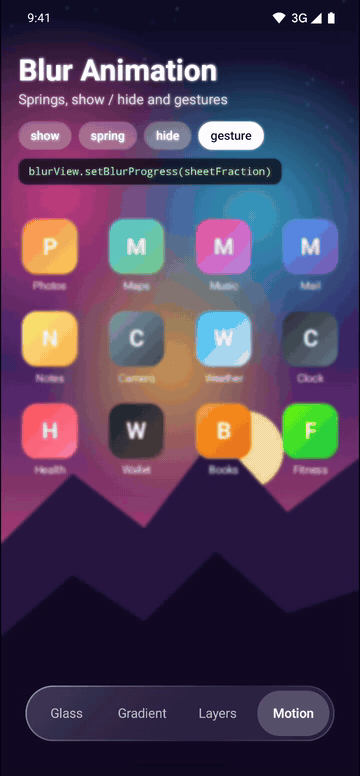

# Animation

`BlurView` has a built-in animator (from `blur-animation`, included with `blur-view`). In Compose, use Compose's animation APIs instead; see [Compose: Animating](compose.md#animating).



```kotlin
// Duration-based
blurView.animateBlur { radius = 30f; duration = 300L }

// Spring
blurView.animateBlur {
    radius = 30f
    spring { dampingRatio = 0.75f; stiffness = 350f }
}

// From/to, several properties at once
blurView.animateBlur { radius(0f, 30f); tintAlpha(0f, 0.2f); spring() }

// Appear and disappear
blurView.show(duration = 350L, radius = 24f)
blurView.hide(duration = 250L)          // ends INVISIBLE

// Gesture-driven: 0 = no blur, 1 = the configured blur
blurView.setBlurProgress(sheetExpandedFraction)
```

<div style="clear: both"></div>

## What can animate

Radius, tint color, tint alpha, saturation and brightness. Each property animates on its own, so starting a tint animation doesn't stop a radius animation.

## Options

| Option | Values |
| --- | --- |
| `duration` | Milliseconds, for a tween. |
| `interpolator` | `BlurInterpolators.FAST_OUT_SLOW_IN` (default), `LINEAR`, `EASE_IN_OUT`, `DECELERATE`, `cubicBezier(x1, y1, x2, y2)`. |
| `spring { }` | `dampingRatio` (default 0.75) and `stiffness` (default 350). Presets: `DAMPING_NO_BOUNCY`, `DAMPING_LOW_BOUNCY`, `DAMPING_MEDIUM_BOUNCY`, `STIFFNESS_LOW`, `STIFFNESS_MEDIUM` on `BlurAnimationBuilder`. |
| `onEnd` | `BlurAnimationListener { finished -> }`. `finished` is false when the animation was interrupted. |

`cancelBlurAnimation()` stops in place; `isAnimating` reports whether anything is running.

## How it behaves

- **Two states.** `config` is the configured state: what `show()` returns to and what `animateBlur` changes. `displayedConfig` is what's on screen now. `show`, `hide` and `setBlurProgress` move only the displayed state, between the configured state and fully hidden (radius 0, no tint).
- **Interruptible.** A new animation starts from what's on screen, and springs keep their velocity. An interrupted `hide()` leaves the view visible.
- **Frame-synchronized.** A Choreographer clock drives each view and uses frame timestamps, so it follows 60, 90 and 120 Hz displays. Springs use the closed-form damped-spring equations, the same as AndroidX `SpringForce`.
- **Reduced motion.** The system's animator duration scale is respected; a scale of 0 jumps to the end. Set `respectsAnimationScale = false` to opt out.
- **Main thread.** Call the animation API and receive callbacks on the main thread.
- **Cheap at zero.** At radius 0 (the end of `hide()`, or progress 0) the capture is skipped entirely.

## Cost

The animator doesn't allocate: a test measures under 1 KB over 1,000 frames. Applying a frame creates one `BlurConfig` copy, and on API 31+ one `RenderEffect`, because Android's `RenderEffect` is immutable. Capture buffers grow in 64 px steps and reuse their memory, so an animating radius rarely resizes them.

Main-thread cost per animated frame is in [Performance](performance.md#animation).
