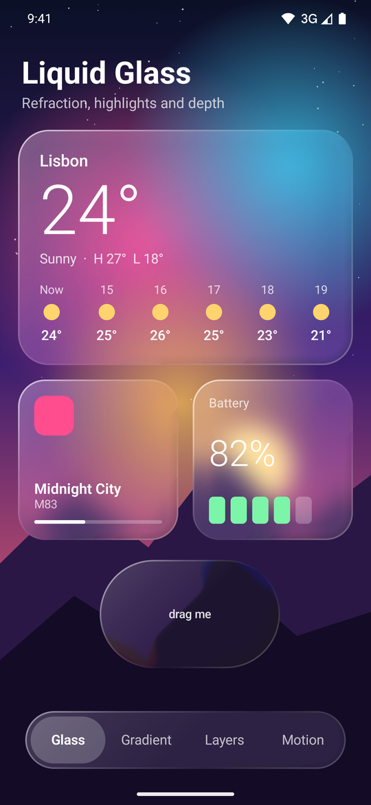
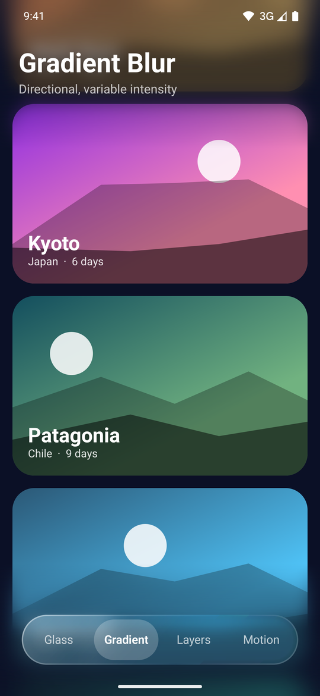
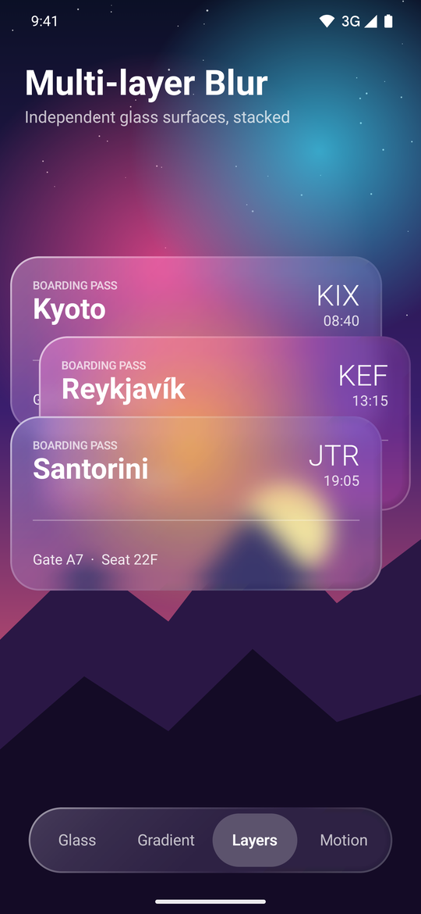

# Effects

## Liquid glass



A glass material drawn on top of the blur:

- **Every API level:** a bright rim on the lit side, a fainter back-lit rim opposite, a gloss across the lit half, and soft shading inside the far edge.
- **API 33+:** refraction, which compresses the content just inside the rim toward the edge like a thick lens, and color dispersion at the rim. This is an AGSL shader chained after the blur, so it runs on the GPU and adds no main-thread time.

The rim follows the corner radius, so set one.

=== "Views"

    ```kotlin
    blurView.blurRadius = 28 * density
    blurView.cornerRadius = 30 * density
    blurView.setTint(Color.WHITE, 0.14f)
    blurView.saturation = 1.3f
    blurView.glass = GlassStyle(
        refraction = 14 * density,   // px
        edgeWidth = 20 * density,    // px
        dispersion = 0.35f,
        highlight = 0.8f,
        gloss = 0.16f,
    )
    ```

=== "Compose"

    ```kotlin
    Modifier.blurSurface {
        radius = 28.dp
        tint(Color.White.copy(alpha = 0.14f))
        saturation = 1.3f
        cornerRadius(30.dp)
        glass(refraction = 14.dp, edgeWidth = 20.dp, dispersion = 0.35f, highlight = 0.8f, gloss = 0.16f)
    }
    ```

| Parameter | View default | Compose default | Meaning |
| --- | --- | --- | --- |
| `refraction` | 24 px | 10 dp | How far the rim bends content at the outermost edge. API 33+. 0 turns refraction off. |
| `edgeWidth` | 28 px | 12 dp | Width of the refracting, lit rim. |
| `dispersion` | 0.3 | 0.3 | 0..1 red/blue separation at the rim. API 33+. |
| `highlight` | 0.6 | 0.6 | 0..1 strength of the rim light. |
| `lightAngle` | 225° | 225° | Direction the light comes from: 0 = right, 90 = bottom, 180 = left, 270 = top. |
| `gloss` | 0.12 | 0.12 | 0..1 strength of the sheen on the lit half. |

`GlassStyle` values are in pixels; the Compose `glass()` takes `Dp`. The lighting fades with the blur radius, so `hide()` and progress 0 remove it too.

!!! tip "Clear glass"
    A very small radius (2 to 4 dp) with a tiny tint and strong refraction gives clear glass: sharp content, bent at the edges. The lens in the showcase app uses `radius = 2.dp`, `refraction = 26.dp`, `edgeWidth = 40.dp`.

## Progressive blur



Blur strength varies linearly along a line across the surface. Where the intensity is 0, the content behind shows through unchanged, so the edge of the surface is invisible.

=== "Views"

    ```kotlin
    header.blurRadius = 40 * density
    header.gradient = BlurGradient.BottomToTop   // full blur at the top, clear at the bottom
    ```

=== "Compose"

    ```kotlin
    Modifier.fillMaxWidth().height(190.dp).blurSurface {
        radius = 40.dp
        gradient = BlurGradient.BottomToTop
    }
    ```

| Preset | Clear at | Fully blurred at | Typical use |
| --- | --- | --- | --- |
| `BottomToTop` | bottom | top | Under the status bar |
| `TopToBottom` | top | bottom | Above a bottom bar |
| `LeftToRight` | left | right | Side panels |
| `RightToLeft` | right | left | Side panels |

A custom gradient takes points as fractions of the surface, (0, 0) top-left to (1, 1) bottom-right, and intensities as fractions of the radius:

```kotlin
BlurGradient(startX = 0f, startY = 0f, endX = 1f, endY = 1f, startIntensity = 0.2f, endIntensity = 1f)
```

Tint, saturation and brightness fade with the intensity too.

## Multi-layer blur



Blur surfaces stack with no setup. Each surface shows every blur surface drawn **before** it, and leaves out itself and everything drawn after it. Stacking order is drawing order: later siblings, or higher `zIndex` in Compose, are on top.

```kotlin
Box {
    Content()
    Card(Modifier.blurSurface { radius = 22.dp; cornerRadius(28.dp) })   // below
    Card(Modifier.blurSurface { radius = 22.dp; cornerRadius(28.dp) })   // on top: blurs the first card too
}
```

On the RenderEffect path, a lower surface appears in an upper one as its unblurred, tinted capture, which the upper surface then blurs once.

<div style="clear: both"></div>
