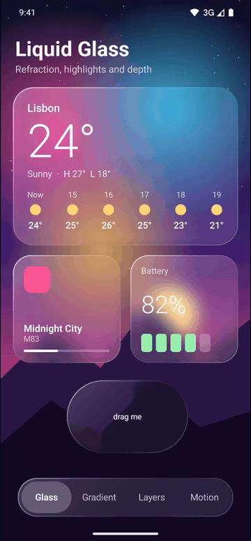
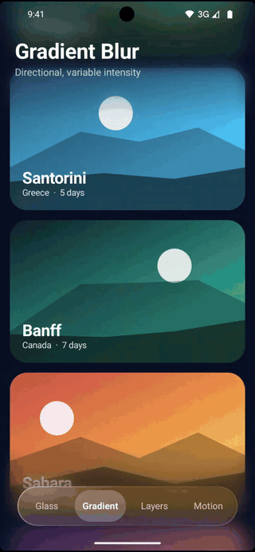
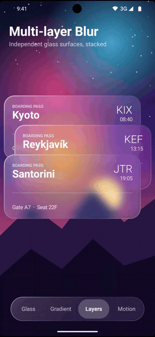
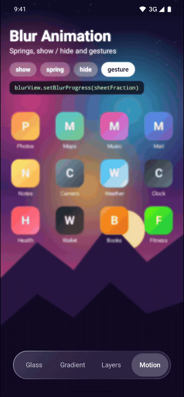

# Blur Engine

Real-time background blur for Android Views and Jetpack Compose, from Android 10 (API 29).

| Liquid Glass | Gradient Blur | Multi-layer Blur | Blur Animation |
| :---: | :---: | :---: | :---: |
|  |  |  |  |

Recorded from the [`blur-showcase`](https://github.com/MrSluffy/blur-engine/tree/HEAD/blur-showcase) app on an Android 15 emulator.

## Features

- **Background blur** behind a `BlurView` or a `Modifier.blurSurface`, with tint, saturation, brightness and rounded corners.
- **Automatic renderer:** `RenderEffect` on API 31+, OpenGL ES 2.0 on API 29 and 30, and a CPU fallback. You don't choose or configure it.
- **Liquid glass:** rim light, gloss and edge shading on every version, plus refraction and color dispersion on API 33+.
- **Progressive blur:** blur strength that fades across the surface, for status bars and bottom bars.
- **Stacking:** blur surfaces show the ones drawn before them, with no setup.
- **Animation:** tweens, springs, `show()` / `hide()` and gesture-driven progress, synchronized to the display and interruptible.

## A first blur

=== "Views"

    ```kotlin
    val bar = BlurView(context).apply {
        blurRadius = 20 * resources.displayMetrics.density
        setTint(Color.WHITE, 0.15f)
    }
    ```

=== "Compose"

    ```kotlin
    Box(
        Modifier.blurSurface {
            radius = 24.dp
            tint(Color.White.copy(alpha = 0.15f))
            cornerRadius(24.dp)
        }
    )
    ```

Next: [Getting started](getting-started.md).
